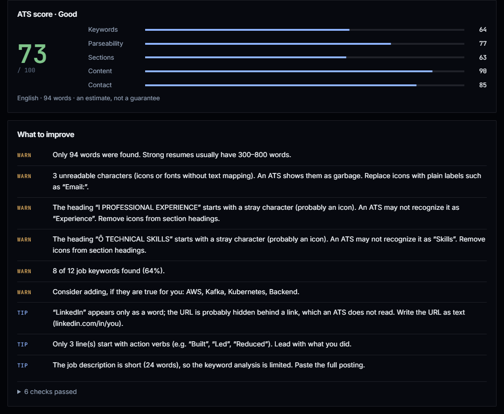
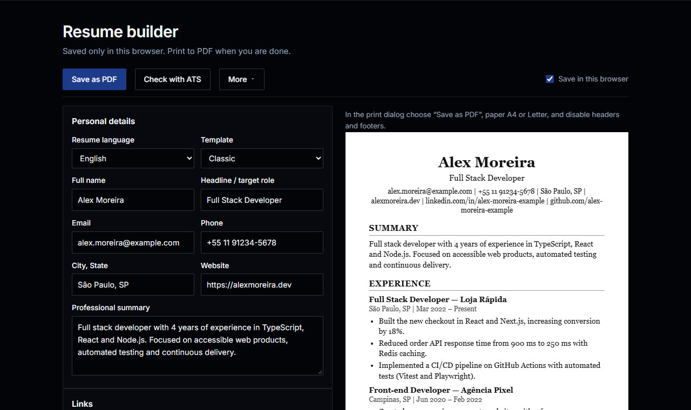

# cvlint

**A linter for your resume.** See what an applicant tracking system (ATS) actually reads, then fix it before you apply.

[](https://github.com/righibe/cvLint/actions/workflows/ci.yml)
[](LICENSE)
[](#how-the-score-works)
[](#português)
[](https://cvlint.righi.dev)

<p align="center">
  
</p>

## Why

Most companies run resumes through an ATS before a human ever sees them. An icon next to a heading, a table or a
two-column layout, and whole sections silently disappear. cvlint shows you the exact text the parser extracts and tells
you what to fix, in plain rules you can read, not a black-box AI score.

- **No AI, no tokens**: every point of the score comes from a readable rule in [`src/lib/ats`](src/lib/ats).
- **Private**: on the website, your file never leaves the browser. Nothing is uploaded or stored.
- **Bilingual**: English and Portuguese resumes and job descriptions ("machine learning" ↔ "aprendizado de máquina").

**Try it:** [cvlint.righi.dev](https://cvlint.righi.dev), also available as a Discord bot in the
[Servidor dos Programadores](https://servidordosprogramadores.com) community.

> If cvlint helped you, a ⭐ helps other people find it.

> 🇧🇷 [Leia em português](#português)

## Features

- **ATS checker**: upload a PDF, DOCX or TXT (or paste text) and see:
  - the exact text an ATS extracts ("What the ATS reads")
  - layout problems: tables, text boxes, multi-column layouts, icon fonts, contact info in headers/footers, page count
  - standard sections (EN/PT), including headings hidden behind icon glyphs ("l EXPERIENCE")
  - contact data written as text (email, phone, LinkedIn URL vs. a hidden link)
  - content signals: metrics, action verbs (EN/PT, STAR-style too), bullets, dates
  - keyword match against a job description, with a bilingual skill dictionary and case-aware matching for ambiguous
    words ("Excel" vs "excel at", "React" vs "React Native")
- **Resume builder**: form → single-column, text-based, ATS-friendly resume. Two templates, EN/PT headings,
  print to PDF, JSON export, import of cvlint or [JSON Resume](https://jsonresume.org) files, autosave to `localStorage`.

<p align="center">
  
</p>

## How the score works

Rule-based and transparent (see [`src/lib/ats/analyze.ts`](src/lib/ats/analyze.ts)). Each category is 0–100 and weighted:

| Category     | With job | Without job |
| ------------ | -------- | ----------- |
| Keywords     | 35%      | –           |
| Parseability | 25%      | 35%         |
| Sections     | 15%      | 25%         |
| Content      | 15%      | 25%         |
| Contact      | 10%      | 15%         |

It is an estimate of common ATS parsing problems, not a prediction of any specific vendor.

## Contributing

Contributions are welcome, including your first one. Look for issues labeled
[`good first issue`](https://github.com/righibe/cvLint/labels/good%20first%20issue): many of them are adding a skill,
a section synonym or a translation, no deep knowledge of the codebase needed. Start with [CONTRIBUTING.md](CONTRIBUTING.md).

## Architecture

```
src/
  proxy.ts                 locale redirect + per-request CSP nonce (Next.js 16 "proxy")
  app/[locale]/            pages (home, checker, builder), rendered per request for the nonce
  components/              UI (checker and builder are client-only)
  i18n/                    locales, negotiation, EN/PT dictionaries
  lib/parser/              file sniffing, PDF (pdf.js), DOCX (streaming unzip), TXT
  lib/ats/                 tokenizer-based scoring engine (pure functions)
  lib/resume/              schema (zod), import/export, storage, plain-text rendering
  lib/security/csp.ts      Content-Security-Policy builder
tests/unit                 Vitest (parser, engine, schema, i18n, CSP)
tests/e2e                  Playwright against the production build (real CSP)
```

## Security

See [SECURITY.md](SECURITY.md) for the threat model. Highlights: files never leave the browser; strict nonce-based CSP
without `unsafe-inline`/`unsafe-eval`; the PDF.js worker runs under its own `default-src 'none'` policy; magic-byte
file detection; zip-bomb and entry-count limits for DOCX; linear-time regexes; only `http(s)` links ever reach an `href`;
prototype-pollution-safe JSON import; pinned GitHub Actions, `npm ci --ignore-scripts`, `npm audit signatures`,
CodeQL and dependency review in CI.

## Development

Requires Node.js 24 (see `.nvmrc`).

```bash
npm ci
npm run dev          # http://localhost:3000
npm run check        # lint + typecheck + unit tests
npm run build && npm run test:e2e   # Playwright (run `npx playwright install chromium` once)
```

## Deploy (VPS + Docker)

```bash
cp .env.example .env   # set SITE_DOMAIN and NEXT_PUBLIC_SITE_URL
docker compose up -d --build
```

Caddy terminates HTTPS automatically; the app container runs as non-root on a read-only filesystem with no internet
access. Point the domain's DNS `A` record to the server and open ports 80 and 443.

## Author

Built by **Bernardo Righi** — portfolio: [righi.dev](https://righi.dev).

## License

[MIT](LICENSE)

---

## Português

**Um linter para o seu currículo.** Veja o que um sistema de recrutamento (ATS) realmente lê e corrija antes de se
candidatar. Open source, grátis, **sem IA**, em **português e inglês**.

### Por quê

A maioria das empresas passa o currículo por um ATS antes de qualquer pessoa ler. Um ícone ao lado do título, uma
tabela ou um layout em duas colunas e seções inteiras somem sem você saber. O cvlint mostra o texto exato que o parser
extrai e diz o que corrigir, com regras que você pode ler, não uma nota de caixa-preta.

**Teste:** [cvlint.righi.dev](https://cvlint.righi.dev), ou pelo bot no Discord do
[Servidor dos Programadores](https://servidordosprogramadores.com).

> Se o cvlint te ajudou, deixa uma ⭐: isso ajuda outras pessoas a encontrarem o projeto.

### O que faz

- **Verificador ATS**: envie PDF, DOCX ou TXT (ou cole o texto) e veja o texto exato que o ATS extrai, problemas de
  layout (tabelas, caixas de texto, colunas, fontes de ícones, contatos no cabeçalho), seções padrão, contatos,
  métricas, verbos de ação, datas e a comparação de palavras-chave com a vaga, com dicionário bilíngue de habilidades.
- **Gerador de currículo**: formulário → currículo de coluna única, baseado em texto e amigável para ATS. Dois modelos,
  títulos em PT/EN, impressão em PDF, exportação JSON, importação de cvlint ou JSON Resume, salvamento automático local.

### Contribuindo

Primeira contribuição? Procure as issues com a etiqueta
[`good first issue`](https://github.com/righibe/cvLint/labels/good%20first%20issue): muitas são adicionar uma
habilidade, um sinônimo de seção ou uma tradução. O passo a passo está no [CONTRIBUTING.md](CONTRIBUTING.md).

### Rodando localmente

```bash
npm ci
npm run dev          # http://localhost:3000
npm run check        # lint + tipos + testes unitários
npm run build && npm run test:e2e
```

### Deploy (VPS + Docker)

Copie `.env.example` para `.env`, ajuste o domínio e rode `docker compose up -d --build`. O Caddy cuida do HTTPS
automaticamente. Aponte o registro `A` do domínio para o servidor e libere as portas 80 e 443.

### Segurança

Veja o [SECURITY.md](SECURITY.md). Os arquivos nunca saem do navegador, a CSP é estrita com nonce, os uploads são
validados por assinatura binária, há proteção contra zip bomb e ReDoS, e só links `http(s)` chegam a um `href`.
